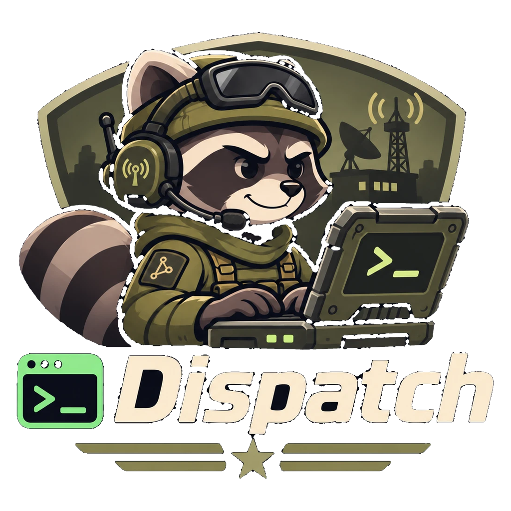
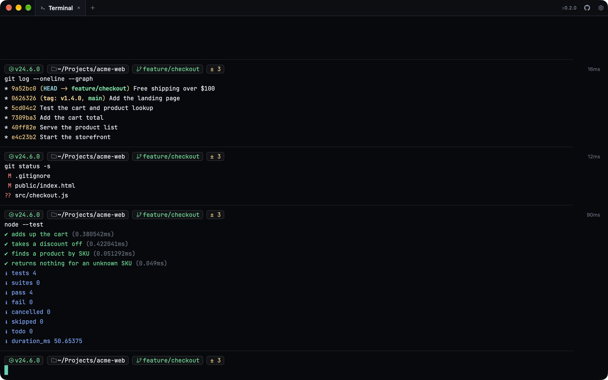
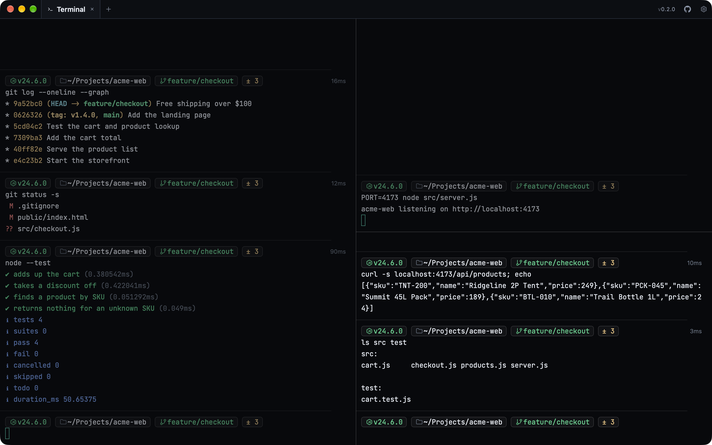
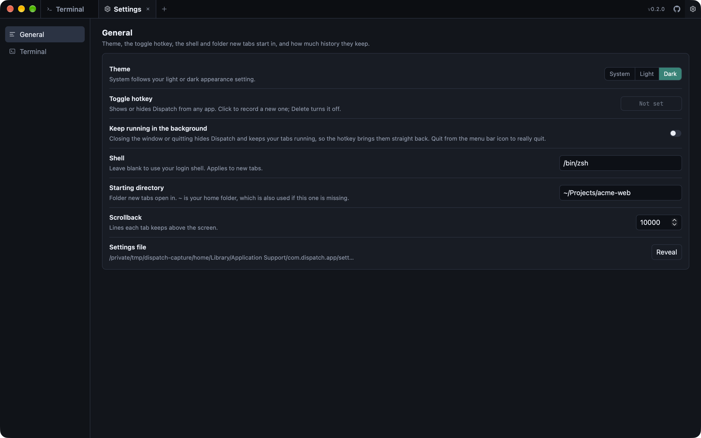
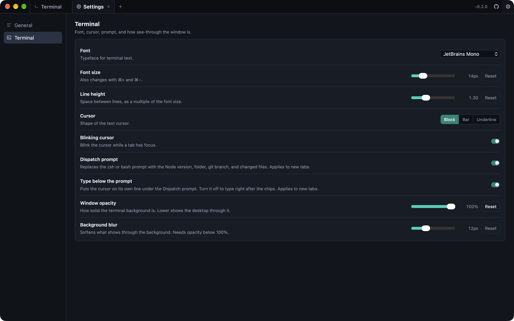
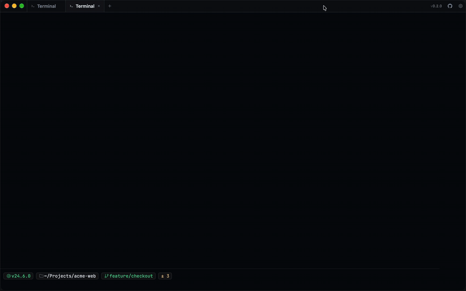

<p align="center">
  
</p>

<p align="center">
  A simple, lightweight, open source terminal for macOS, Windows, and Linux.
</p>

<p align="center">
  <a href="https://github.com/fylzero/dispatch/releases/latest/download/Dispatch-macos-arm64.dmg"></a>
  <a href="https://github.com/fylzero/dispatch/releases/latest/download/Dispatch-windows-x64.exe"></a>
  <a href="https://github.com/fylzero/dispatch/releases/latest/download/Dispatch-linux-x64.AppImage"></a>
</p>

<p align="center">
  Also available:
  <a href="https://github.com/fylzero/dispatch/releases/latest/download/Dispatch-windows-arm64.exe">Windows ARM64</a> ·
  Linux <a href="https://github.com/fylzero/dispatch/releases/latest/download/Dispatch-linux-x64.deb">.deb</a>,
  <a href="https://github.com/fylzero/dispatch/releases/latest/download/Dispatch-linux-x64.rpm">.rpm</a> ·
  Linux ARM64 <a href="https://github.com/fylzero/dispatch/releases/latest/download/Dispatch-linux-arm64.AppImage">AppImage</a>,
  <a href="https://github.com/fylzero/dispatch/releases/latest/download/Dispatch-linux-arm64.deb">.deb</a>,
  <a href="https://github.com/fylzero/dispatch/releases/latest/download/Dispatch-linux-arm64.rpm">.rpm</a>
</p>

<p align="center">
  <a href="https://buymeacoffee.com/fylzero"></a>
</p>

## What is Dispatch?

Dispatch is a plain, fast terminal with tabs and split panes, built with Tauri, Vue, and Rust. No accounts, no AI, no cloud: it starts your shell and gets out of the way.

It runs your own login shell (zsh, bash, fish, PowerShell, or whatever you use) in a real pseudo-terminal, so your prompt, aliases, and tools work exactly as they do anywhere else.

## Features

- **Tabs**: Open, close, reorder by dragging, and jump between them from the keyboard
- **Split panes**: Split the focused pane side by side or top and bottom, and split those panes again as deep as you like (up to 8 side by side or 12 stacked in one split). Resize by dragging the dividers, and move between panes from the keyboard
- **See-through window**: Set the terminal background's opacity, with an optional blur behind it (macOS and Windows)
- **Themes**: Light, dark, or follow the system
- **Fonts and cursor**: Pick the font, size, line height, and cursor shape
- **Your shell**: Uses your login shell, or any shell you name in Settings
- **Clickable links**: ⌘-click (Ctrl-click on Windows and Linux) a URL to open it
- **Toggle from anywhere**: ⌘\` (Ctrl+\` on Windows and Linux) shows or hides Dispatch from any app. Change it, or turn it off, in Settings
- **Lives in the menu bar**: Closing the window or quitting hides Dispatch with your tabs still running, until you quit from the menu bar icon. Turn off *Keep running in the background* in Settings to quit the usual way
- **Automatic updates**: Checks GitHub for a new release on launch, and from the Change Log

## Keyboard Shortcuts

| Action | macOS | Windows and Linux |
| --- | --- | --- |
| New tab | ⌘T | Ctrl+Shift+T |
| Close pane, or tab | ⌘W | Ctrl+Shift+W |
| Split side by side | ⌘D | Ctrl+Shift+D |
| Split stacked | ⌘⇧D | Ctrl+Shift+E |
| Move between panes | ⌘⌥ + arrow keys | Alt+Shift + arrow keys |
| Previous / next tab | ⌘⇧[ / ⌘⇧] | Ctrl+Shift+[ / Ctrl+Shift+] |
| Go to tab 1–8, last tab | ⌘1–⌘8, ⌘9 | Alt+1–Alt+8, Alt+9 |
| Clear the screen | ⌘K | Ctrl+Shift+K |
| Copy / paste | ⌘C / ⌘V | Ctrl+Shift+C / Ctrl+Shift+V |
| Bigger / smaller / actual size | ⌘+ / ⌘− / ⌘0 | Ctrl++ / Ctrl+− / Ctrl+0 |
| Settings | ⌘, | Ctrl+, |
| Show or hide Dispatch, from any app | ⌘\` | Ctrl+\` |

On Windows and Linux, shortcuts that would take a key from the shell (Ctrl+C, Ctrl+W, Ctrl+D and so on) use Ctrl+Shift instead.

## Screenshots

### Command Blocks

<p align="center">
  
</p>

Each command gets its own block, headed by chips for the Node version, folder, git branch, and changed files, with how long it took.

### Split Panes

<p align="center">
  
</p>

Split side by side or stacked, as deep as you like, and drag the dividers to resize.

### Settings

<p align="center">
  
</p>

Pick the theme, the toggle hotkey, your shell, and the folder new tabs start in.

<p align="center">
  
</p>

Set the font, cursor, prompt, and how see-through the window is.

### Demo

<p align="center">
  
</p>

## Download and Install

### Requirements

- **macOS**: Apple Silicon (ARM64) required. Intel Macs are not currently supported.
- **Windows**: Windows 10 or 11, x64 or ARM64
- **Linux**: x64 or ARM64 with WebKitGTK 4.1 (Ubuntu 22.04, Debian 12, Fedora 36, or newer)

Dispatch updates itself: it checks GitHub for a newer release on launch and offers to install it.

### Installation on macOS

1. Download the latest release: [Dispatch-macos-arm64.dmg](https://github.com/fylzero/dispatch/releases/latest/download/Dispatch-macos-arm64.dmg)
2. Open the DMG and drag Dispatch to your Applications folder
3. Launch Dispatch from Applications

Or install it with [Homebrew](https://brew.sh):

```sh
brew install fylzero/tap/dispatch
```

Dispatch updates itself, so Homebrew leaves upgrades to it. If Dispatch is already in Applications, add `--force` so Homebrew takes it over.

### Installation on Windows

1. Download the latest installer: [Dispatch-windows-x64.exe](https://github.com/fylzero/dispatch/releases/latest/download/Dispatch-windows-x64.exe), or [Dispatch-windows-arm64.exe](https://github.com/fylzero/dispatch/releases/latest/download/Dispatch-windows-arm64.exe) on ARM PCs like Snapdragon laptops
2. Run it. It installs Dispatch for your user account without asking for administrator rights
3. Launch Dispatch from the Start menu

The installer isn't code-signed yet, so Windows SmartScreen may say **Windows protected your PC**. Click **More info**, then **Run anyway**. **Help → Check for Updates…** keeps Dispatch current.

### Installation on Linux

Pick one package. Each one updates itself from **Help → Check for Updates…**; the `.deb` and `.rpm` ask for your password to install the update.

| Package | Install |
| --- | --- |
| [AppImage](https://github.com/fylzero/dispatch/releases/latest/download/Dispatch-linux-x64.AppImage) (any distro) | `chmod +x Dispatch-linux-x64.AppImage`, then run it |
| [.deb](https://github.com/fylzero/dispatch/releases/latest/download/Dispatch-linux-x64.deb) (Debian, Ubuntu, Mint) | `sudo apt install ./Dispatch-linux-x64.deb` |
| [.rpm](https://github.com/fylzero/dispatch/releases/latest/download/Dispatch-linux-x64.rpm) (Fedora, RHEL, openSUSE) | `sudo dnf install ./Dispatch-linux-x64.rpm` |

Use the `arm64` files on ARM machines. The `.deb` and `.rpm` install WebKitGTK for you.

## Development

Want to build Dispatch from source or contribute? You'll need **Bun**, **Rust**, and a C toolchain: **Xcode Command Line Tools** on macOS, the **Visual Studio Build Tools** on Windows, or the **WebKitGTK** development packages on Linux.

### Prerequisites

#### 1. Native build tools

**macOS:** Xcode Command Line Tools provide the C/C++ compiler Rust uses.

```bash
xcode-select --install
```

**Linux:** install a compiler and WebKitGTK. On Debian or Ubuntu:

```bash
sudo apt install build-essential curl libwebkit2gtk-4.1-dev libxdo-dev libssl-dev librsvg2-dev
```

For Fedora, Arch, and other distros, see [Tauri's Linux prerequisites](https://v2.tauri.app/start/prerequisites/#linux).

**Windows:** install the [Build Tools for Visual Studio](https://visualstudio.microsoft.com/visual-cpp-build-tools/) with the **Desktop development with C++** workload. See [Tauri's Windows prerequisites](https://v2.tauri.app/start/prerequisites/#windows) for details. WebView2 already comes with Windows 10 and 11.

#### 2. Bun

Install with the official script from [bun.sh](https://bun.sh/):

```bash
curl -fsSL https://bun.sh/install | bash
```

On Windows, run `powershell -c "irm bun.sh/install.ps1 | iex"` instead.

#### 3. Rust

Install the official toolchain with [rustup](https://www.rust-lang.org/tools/install):

```bash
curl --proto '=https' --tlsv1.2 -sSf https://sh.rustup.rs | sh
```

On Windows, download and run `rustup-init.exe` from the same page and keep the default MSVC toolchain. Open a new terminal afterwards.

### Building and Running

```bash
git clone https://github.com/fylzero/dispatch.git
cd dispatch
bun install
bun run tauri dev
```

This starts Vite on `http://localhost:1450` for the Vue UI, compiles the Rust/Tauri shell, and opens the Dispatch window. On Windows, run `bunx tauri dev` instead. The first build downloads and compiles every crate, which takes a few minutes; later runs are much faster.

#### Export a native app

Release builds also sign the update files, so they need the updater key in the environment:

```bash
export TAURI_SIGNING_PRIVATE_KEY="$(cat ~/.tauri/dispatch.key)"
export TAURI_SIGNING_PRIVATE_KEY_PASSWORD=""
bun run tauri build
```

| Platform | Artifacts |
| --- | --- |
| macOS | `src-tauri/target/release/bundle/macos/Dispatch.app` and a `.dmg` |
| Linux | AppImage, `.deb`, and `.rpm` under `src-tauri/target/release/bundle/` |
| Windows | NSIS installer and `.msi` under `src-tauri/target/release/bundle/` |

macOS Gatekeeper may warn that an unsigned local build is unidentified: right-click the app, choose **Open**, then confirm.

### Publishing Signed Releases

Pushing a `v*` tag runs the Release workflow. It builds and notarizes the macOS app first, then builds the Linux x64 and ARM64 packages, then the Windows x64 and ARM64 installers, and adds them all, with a signed `latest.json` for the updater, to the same GitHub release. The release notes come from `src/changelog.ts`, so add an entry for the new version first.

See [macOS release setup](docs/macos-releases.md) for Apple enrollment, repository secrets, and the signing and notarization checks, [Linux releases](docs/linux-releases.md) for the Linux packages and how they update, and [Windows releases](docs/windows-releases.md) for the Windows installers and code signing.

### App Icon

The icons come from two images in the repo root:

- `app-icon.png`: the logo on a transparent square, used for Windows, Linux, and this README
- `app-icon-macos.png`: the squircle tile, used for the macOS icon in the Dock and Command-Tab

After changing either, regenerate every size with `bun run icons`. `app-icon.png` was made from `scripts/icons/logo-source.webp` with `scripts/icons/cutout.py` (removes the flat background), and `app-icon-macos.png` from the squircle artwork with `scripts/icons/fit-squircle.py` (cuts the tile off its background and fits it to Apple's icon grid); see `scripts/icons.sh` for the commands.

## License

MIT
